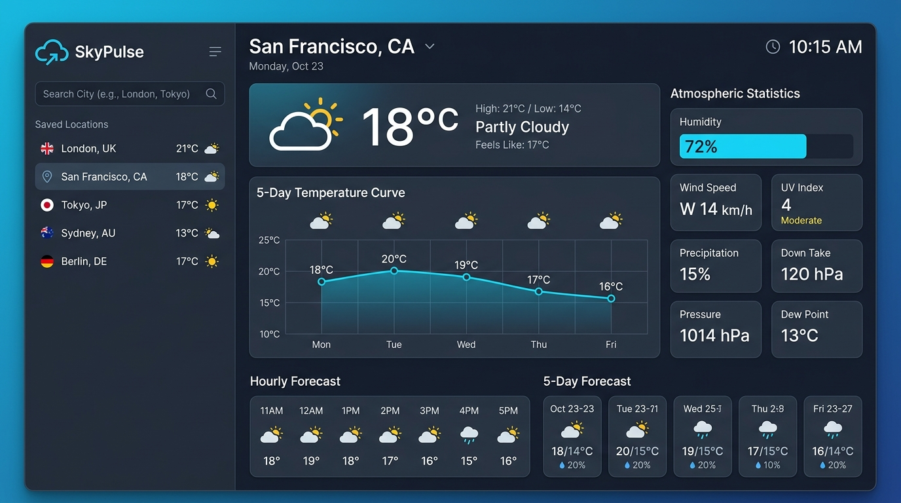
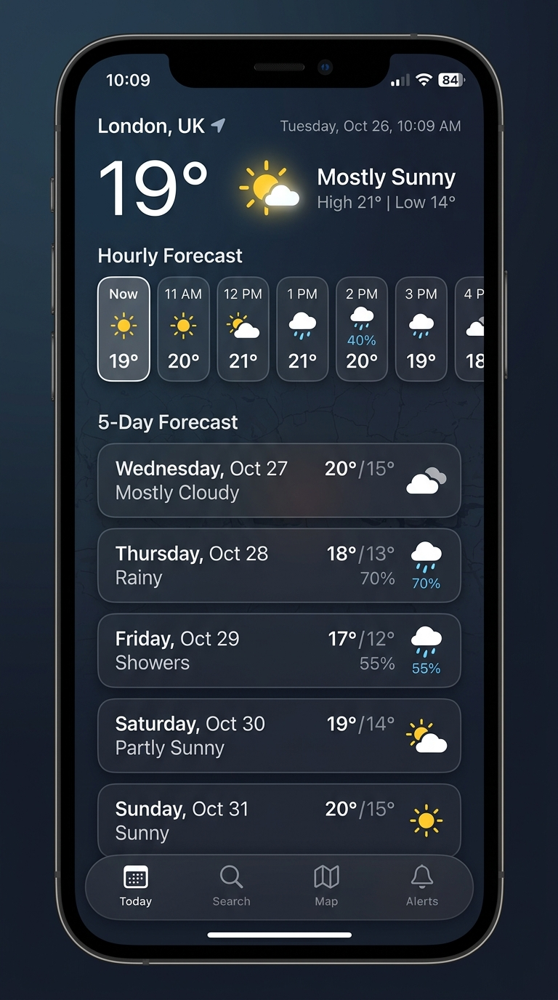

# 🌤️ Weather Checker App

> **Global Meteorological Forecast Application Querying the Open-Meteo REST API with 5-Day Temperature Predictions**

A high-precision, production-grade meteorological dashboard built with React 19, TypeScript, and Tailwind CSS. The application integrates directly with the **Open-Meteo REST API** and **Open-Meteo Geocoding API** to provide instantaneous atmospheric telemetry, 5-day predictive temperature modeling, interactive SVG trend visualizers, and diurnal cycle breakdowns for any location worldwide.

---

## 📸 Screenshots & UI Showcase

### Desktop Meteorological Console

*Desktop overview displaying current weather conditions, 5-day temperature curve, 24-hour hourly progression, and atmospheric telemetry matrix.*

### Mobile Forecast Interface

*Responsive mobile experience showing 5-day daily prediction cards, temperature bounds, and hourly forecast carousel.*

---

## ⚡ Features

### 1. Live Open-Meteo REST API Integration
- **Zero API Key Barrier**: Communicates directly with the Open-Meteo public REST API endpoints with no paywalls or authentication tokens required.
- **High-Resolution Meteorological Models**: Queries global numerical weather models (ECMWF, GFS, ICON, Météo-France) through unified endpoints.
- **Dual Endpoint System**: Seamlessly coordinates both the **Weather Forecast API** and the **Geocoding API**.

### 2. 5-Day Temperature Predictions & Analytics
- **Diurnal Extremes (High / Low)**: Daily maximum and nocturnal minimum temperatures with proportional color spectrum indicator bars.
- **Predictive Trajectory**: 5-day forward outlook highlighting precipitation probability, maximum wind gusts, and peak UV index.
- **Deep-Dive Day Analysis**: Modal inspector providing 24-hour drilldowns partitioned into Morning (06:00-12:00), Afternoon (12:00-18:00), Evening (18:00-22:00), and Overnight (22:00-06:00).

### 3. Interactive SVG Trend Visualizer
- **Dual Visual Modes**:
  - *5-Day High/Low Envelope*: Smooth Bézier curve charting daily peaks (amber) and lows (cyan) with shaded range fill.
  - *Continuous 120-Hour Timeline*: Uninterrupted time-series temperature graph with day division lines and crosshair hover HUD.
  - *Selected Day 24-Hour Horizon*: Focused single-day hourly curve.
- **Interactive Mouse Crosshair**: Floating monospace HUD that snaps to hourly intervals displaying exact temperature, apparent "feels like" temp, rain probability, and wind vectors.

### 4. WMO Meteorological Code Translation
- Full interpretation table for the official **World Meteorological Organization (WMO)** weather codes (0 to 99).
- Contextual descriptions explaining physical atmospheric phenomena (e.g., radiative cooling inversions, convective thunder cells, rime fog).
- Day/Night adaptive visual icons (Sun, Moon, CloudSun, CloudMoon, Rain, Thunderstorm, Snow, Fog).

### 5. Global Search & Geolocation
- **Debounced Instant Search**: Sub-300ms autocomplete querying thousands of global meteorological stations.
- **Country Flags & Coordinates**: Station results display administrative divisions, country flags, and exact GPS coordinates.
- **Browser Geolocation**: One-click device GPS coordinate acquisition (`navigator.geolocation`).
- **Recent Stations History**: Automatically stores recent searches in local storage with one-click recall.
- **Quick Stations Bar**: Instant access to major global hubs (Tokyo, London, New York, Paris, Sydney, Cairo, Reykjavik, São Paulo, Singapore, Berlin).

### 6. Atmospheric Telemetry Matrix
- **Relative Humidity & Dew Point**: Precise moisture measurement with calculated dew point using the Magnus formula.
- **Barometric Pressure**: Mean Sea Level (MSL) pressure with atmospheric regime classification (Ridge vs Trough).
- **Ultraviolet (UV) Index**: Color-stepped WHO scale with solar hazard guidance.
- **Wind Vector Dynamics**: Beaufort wind scale, cardinal directions, and dynamic rotating compass needle.
- **Solar Ephemeris**: Local dawn (sunrise) and dusk (sunset) timings.

### 7. Customization & Data Export
- **Unit Conversions**: Instant toggle between Celsius (°C) and Fahrenheit (°F), plus km/h, mph, and m/s for wind.
- **Export Options**: Export comprehensive forecast data as **JSON** or **CSV** for offline analysis.
- **Quick Share**: One-click formatted clipboard summary of current conditions.

---

## 🛠️ Tech Stack & Architecture

| Layer | Technology | Purpose |
| :--- | :--- | :--- |
| **Framework** | [React 19](https://react.dev/) | Component architecture, state hooks, and fast rendering |
| **Language** | [TypeScript](https://www.typescriptlang.org/) | Type-safe interfaces for Open-Meteo REST payloads and components |
| **Styling** | [Tailwind CSS v4](https://tailwindcss.com/) | Modern utility-first styling with zero-pill metadata discipline |
| **Icons** | [Lucide React](https://lucide.dev/) | Clean, accessible SVG iconography |
| **Data Provider** | [Open-Meteo REST API](https://open-meteo.com/) | Real-time meteorological forecasting and global geocoding |
| **Build Tool** | [Vite 8](https://vitejs.dev/) | Fast build and development server |

---

## 📦 Installation & Setup

Follow these instructions to run the application locally on your machine.

### Prerequisites
- **Node.js**: Version `18.0.0` or higher
- **npm** (comes with Node.js) or **yarn** / **pnpm**

### Step-by-Step Instructions

1. **Clone the repository**:
   ```bash
   git clone https://github.com/your-username/weather-checker-app.git
   cd weather-checker-app
   ```

2. **Install project dependencies**:
   ```bash
   npm install
   ```

3. **Start the local development server**:
   ```bash
   npm run dev
   ```
   The application will boot at `http://localhost:3000`.

4. **Build for production**:
   ```bash
   npm run build
   ```
   Generates optimized static assets in the `dist/` directory ready for deployment on Vercel, Netlify, Cloud Run, or GitHub Pages.

---

## 🌐 Open-Meteo REST API Endpoints Used

### 1. Forecast REST API
```http
GET https://api.open-meteo.com/v1/forecast?latitude={lat}&longitude={lon}&current=temperature_2m,relative_humidity_2m,apparent_temperature,is_day,precipitation,weather_code,cloud_cover,pressure_msl,wind_speed_10m,wind_direction_10m,wind_gusts_10m,uv_index&hourly=temperature_2m,relative_humidity_2m,dew_point_2m,apparent_temperature,precipitation_probability,precipitation,weather_code,pressure_msl,wind_speed_10m,uv_index,visibility&daily=weather_code,temperature_2m_max,temperature_2m_min,apparent_temperature_max,apparent_temperature_min,sunrise,sunset,uv_index_max,precipitation_sum,precipitation_probability_max,wind_speed_10m_max&forecast_days=7&timezone=auto&temperature_unit={celsius|fahrenheit}&wind_speed_unit={kmh|mph|ms}
```

### 2. Geocoding Search REST API
```http
GET https://geocoding-api.open-meteo.com/v1/search?name={query}&count=10&language=en&format=json
```

---

## 📁 Project Structure

```text
├── index.html                   # HTML entry point with fonts & meta tags
├── metadata.json                # AI Studio application metadata
├── package.json                 # Project dependencies & scripts
├── README.md                    # Project documentation & GitHub instructions
├── src/
│   ├── App.tsx                  # Main application orchestrator & state container
│   ├── main.tsx                 # React DOM mount point
│   ├── index.css                # Global Tailwind CSS and scrollbar styles
│   ├── assets/
│   │   └── images/              # High-resolution screenshots for GitHub showcase
│   ├── components/
│   │   ├── Header.tsx           # 3-zone Top Bar Contract navigation
│   │   ├── SearchBar.tsx        # Geocoding search & recent station selector
│   │   ├── CurrentWeatherCard.tsx # Hero current conditions card
│   │   ├── FiveDayForecast.tsx  # 5-day daily temperature predictions
│   │   ├── TemperatureChart.tsx # Interactive SVG high/low & hourly trend chart
│   │   ├── HourlyForecastStrip.tsx # Horizontal 24-hour sequence
│   │   ├── AtmosphericGrid.tsx  # Telemetry cards (pressure, humidity, UV, wind)
│   │   ├── DayDetailModal.tsx   # Drilldown inspector for specific days
│   │   ├── GithubDocsModal.tsx  # In-app GitHub instructions & screenshots viewer
│   │   └── WeatherIcon.tsx      # WMO code to Lucide icon mapper
│   ├── services/
│   │   └── openMeteo.ts         # REST API clients & data transformations
│   ├── types/
│   │   └── weather.ts           # TypeScript interfaces for API and domain models
│   └── utils/
│       └── weatherCodes.ts      # WMO code translations & Beaufort wind index
├── tsconfig.json                # TypeScript configuration
└── vite.config.ts               # Vite bundler configuration
```

---

## 📄 License

This project is licensed under the Apache 2.0 License.
Weather forecasts powered by [Open-Meteo](https://open-meteo.com/) under Creative Commons Attribution 4.0 International (CC BY 4.0).
